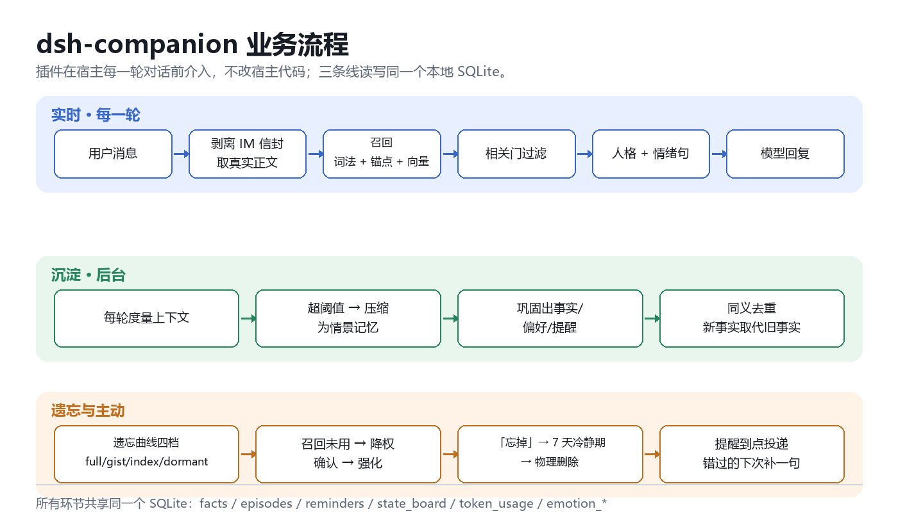

# dsh-companion · 珞然

> 给一个人的长期记忆管家：会记住，会遗忘，会主动提醒。

`dsh-companion` 是 DeepSeek Harness（DSH）的插件。它让对话里的 AI 有一份**留在你自己机器上的长期记忆**：把聊过的事沉淀成事实、经历与提醒，按遗忘曲线淡化不再提起的内容，并在合适的时候主动开口。



`MIT` · `Node.js ≥ 24` · `零运行时依赖` · `本机 SQLite` · 当前版本 **v0.7.6**（[变更记录](CHANGELOG.md)）

---

## 它能做什么

- **不再失忆**：对话快满时自动压缩成「情景记忆」，再巩固出事实、偏好和要提醒的事。下次你问「我上次说的那个…」，它能找回来。
- **上下文不再爆满**：工作记忆有上限，超过阈值就压缩；压缩有迟滞和冷却，不会每轮空转。
- **像人一样遗忘**：久不提起的内容按遗忘曲线淡化；召回了却没用上会降权，被你确认会加深；说一句「忘掉」就真的删。
- **记不清就直说**：被遗忘、被取代或涉密的内容不会被召回，它会说「不记得了」，不编造。
- **主动但有分寸**：提醒支持每日 / 每周重复，错过了会在你下次说话时补一句；安静时段和每日上限都可配置。
- **有人格、有情绪**：身份、性格、说话方式全由人格卡决定，兼容 Character Card V2/V3；可选的情绪状态会影响她此刻的语气。
- **记忆不出你的机器**：所有数据存在本机 SQLite；密码、验证码、卡号等凭据在落库前自动脱敏。

## 工作原理

插件在宿主每一轮对话前介入，不改宿主代码。三条线并行：

| 线 | 做什么 |
| --- | --- |
| **实时（每一轮）** | 剥离 IM 信封取真实正文 → 判断是否在回忆 → 关键词 + 稀有锚点 + 可选向量召回，过相关门 → 人格卡与情绪句 → 回复 |
| **沉淀（后台）** | 上下文超阈值 → 压缩为情景记忆 → 巩固出事实 / 偏好 / 提醒 → 同义去重、新事实取代旧事实 |
| **遗忘与主动** | 遗忘曲线四档（full / gist / index / dormant）、用上才强化、「忘掉」后 7 天冷静期再物理删除、提醒到点投递 |

所有环节读写同一个本地库。

## 快速开始

### 1. 环境

- Node.js **≥ 24**（使用内置 `node:sqlite`，启动时的 ExperimentalWarning 属正常）。
- 无需 `npm install`，无需构建。

### 2. 加载插件

在 DSH profile 的 `cordis.patch.yml` 里加入插件，`name` 指向**入口文件**（不能只指目录）：

```yaml
- insert:
    - id: dsh-companion
      name: '/path/to/dsh-companion/src/index.js'
      config:
        dbPath: ./.data/companion.db
```

同时开启宿主压缩能力，由插件决定何时压缩：

```yaml
- id: compaction-basic
  disabled: false
  config:
    auto: false
```

改完重载 profile。输入 `/status` 能看到状态面板即表示加载成功。

### 3. 首次自检（推荐）

```bash
node scripts/calibrate/run.mjs
```

按本机内存与模型上下文写出建议配置 `.data/config.suggested.yml`，核对后把需要的键复制进配置。它不会自动改你的配置或数据。

### 4. 换上你的人格卡（可选）

```yaml
persona:
  cardPath: persona.json   # 相对 DSH_HOME；也可写绝对路径
```

字段见 [persona.example.md](persona.example.md) 与 [人格卡说明](docs/persona-card.md)，示例卡在 [examples/](examples/)。改卡后需重启宿主。

## 日常使用

### 命令

宿主只接受 ASCII 命令名，中文是对应含义：

| 命令 | 含义 | 常用写法 |
| --- | --- | --- |
| `/memory` | 记忆 | `列表 [关键词]`、`忘掉 <id>`、`改 <id> <内容>`、`置顶`、`治理 [--dry-run]`、`导出 [md\|json]` |
| `/status` | 状态 | 人格卡、压缩与巩固、召回、情绪、今日用量、最近失败 |
| `/cost` | 成本 | token 用量与来源占比 |
| `/threads` | 线程 | 列出线程 |
| `/chat-off` / `/chat-on` | 关闭 / 恢复轻闲聊 | 开关写库，重启后仍有效 |
| `/stop-task` | 停止任务（中文 `/停止任务`） | 无参数：查看用法与在跑清单；带 taskId：只中止该任务 |

> **带参命令的平台差异（v0.7.18）**：`/memory` 现在向宿主声明了参数输入（宿主契约见
> `@deepseek-ai/dsh-commands` 的 `CommandInputDescriptor`）。Web UI 会据此弹参数输入框：
> 裸 `/memory` 回车先出输入框，**留空提交等价于无参**（落列表，输出与以前逐字一致）；
> **QQ / IM 侧只支持无参命令**，`/memory` 落列表；带参操作中「改」可让模型调用现有工具
> 完成（`memory_update`；`memory_write` / `memory_forget` 同名工具也都可用），治理、导出、
> 回填、周报没有对应工具，请到 Web UI 执行。本版不识别消息文本里的命令，也不新增
> `memory_*` 工具。

### 模型可用的工具

`memory_search`、`memory_write`、`memory_update`、`memory_forget`、`reminder_add`、`reminder_done`、`thread_list`、`thread_run`、`task_run`、`cost_report`。宿主不支持会话控制时，线程类工具会返回 `capability_missing`，其余不受影响。

参数与返回见 [使用手册](docs/usage.md)。

## 配置

常用项（完整列表见 [config.example.yml](config.example.yml) 与 [使用手册](docs/usage.md)）：

| 配置键 | 默认 | 说明 |
| --- | --- | --- |
| `workingMemoryTokens` | `32000` | 工作记忆上限 |
| `compactAtTokens` | `24000` | 超过即触发压缩与巩固 |
| `compactHardTokens` | `40000` | 安全阀 |
| `retainTokens` | `6144` | 压缩时保留的最近对话 |
| `compactMinRegionTokens` | `4096` | 巩固出的区间小于它就不登记压缩（`0` 关闭闸门） |
| `timezone` | `Asia/Shanghai` | 安静时段、每日任务、日界线都按它算 |
| `quietStart` / `quietEnd` | `23:00` / `08:00` | 安静时段 |
| `proactiveDailyCap` | `3` | 每日主动消息上限，`0` 关闭 |
| `purgeAfterDays` | `7` | 「忘掉」后的冷静期 |
| `dbPath` | `./.data/companion.db` | 数据库位置 |
| `vector.enabled` | `false` | 可选向量召回（`hash` / `local` / `remote`） |
| `persona.cardPath` | `null` | 人格卡路径，`null` 用内置「珞然」 |
| `budget.dailyHardLimit` | `3000000` | 每日 token 硬上限 |
| `quota.source` | `none` | 设为 `file` 时读额度快照，额度紧张只停后台 |
| `compact.minIncrementTokens` / `compact.cooldownTurns` | `4096` / `3` | 压缩迟滞，防止每轮空转 |
| `compact.backfill.enabled` | `false` | 历史回填开关（v0.7.17 H1-A：只影响预演提示，执行留 H1-B） |
| `compact.backfill.chunkTokens` | `32768` | 回填单批 token 上限（1024..262144） |
| `compact.backfill.maxPerDay` | `6` | 回填每日最多推进批数（1..50） |
| `consolidate.dedupeSkip` / `consolidate.dedupeAsk` | `0.85` / `0.5` | 巩固写库前的近似查重：≥ skip 只强化旧条，ask–skip 之间交模型判定 same/update/new |
| `consolidate.maxProjectFacts` | `5` | 每次巩固新增 project + knowledge 事实的上限（`0` 表示不写工程类事实） |
| `govern.autoDedupeThreshold` | `0.6` | deep-sleep 自动去重的配对下限（判 same 才 supersede，不物理删） |
| `decay.projectDormantDays` | `30` | project / knowledge 事实多久没被召回或强化就转 dormant（`0` 关闭） |
| `reminderStaleDays` / `reminderTodoStaleDays` | `30` / `7` | 无到期时间的承诺 / 待办多久没更新就置 expired（只改状态不删） |
| `subagent.model` | `""` | `task_run` / `thread_run` 交给子代理时使用的模型；空表示沿用主会话路由（仅允许 profile 白名单内的两项） |
| `subagent.concurrency` | `2` | 同时运行的子代理任务上限，超出排队 |
| `bg.workRoot` | `""` | 后台长任务的工作根；留空则 `bg_run` 直接返回不可用（建议 `/opt/dsh-companion/.data/work/`） |
| `bg.interpreters` | `[python3, bash, node]` | `bg_run` 允许的解释器白名单（只比 `argv[0]`，不看脚本内容） |
| `bg.runAs` | `""` | 后台任务的运行身份；默认空 = 与 50041 相同（当前 ubuntu uid 1000）；非 root 时走用户级 systemd，`runAs` 必须为空（非空则 `bg_run` 不可用，其余功能照常） |
| `bg.env` | `[]` | 额外从 50041 进程透传给后台任务的变量名（`PATH` / `HOME` 恒透传） |
| `bg.logMaxMB` | `50` | 后台任务日志保留上限（MB，0–1024），超出只留尾部；`0` 关闭 |
| `bg.maxDeadlineMin` | `360` | 后台任务时长上限（分钟），超时由 `RuntimeMaxSec` 主杀、插件兜底 TERM→KILL |
| `bg.memoryMax` / `bg.cpuQuota` | `4G` / `200%` | 后台任务的 cgroup 资源上限（2 核） |
| `bg.minFreeDiskMB` | `1024` | workRoot 剩余空间低于它就拒绝启动 |
| `bg.wakeBudgetPerAgent` | `3` | 每个发起子代理最多被唤醒几次，超预算直接投主会话 |
| `bgConcurrency` | `1` | 同时运行的后台任务上限；训练这类占资源的任务默认不并行 |
| `receipt.im.botId` / `receipt.im.targetId` | `""` | **v0.7.15 起已停用**：回执不再经 dsh-im 直发，配置只保留读入与提示，`/状态` 会标注「receipt.im 已停用」 |
| `receipt.sessionNotice` | `true` | **v0.7.15 起不再读取**：回执一律以 notice 交主会话（开关保留只为兼容旧配置） |

token 四档须满足 `retainTokens < compactAtTokens < workingMemoryTokens < compactHardTokens`。未知配置键只记警告，不阻断启动。

**任务回执的投递通道（v0.7.15 起）**：`task_run` 的子代理回执（含后台任务兜底）只交给**主会话**，
不再直发到 IM、也不伪装成用户发言。投递形状是一条 notice（`source.kind = companion-task-receipt`、
`form = notice`，正文前注明「这是后台任务回执，不是用户发言」），对齐宿主 subagent 结算的唤醒语义：
主会话空闲走 `next-turn`（followup），忙时走 `next-step`（steer），两者都唤醒——由主会话模型决定是否、
何时、怎样告诉用户。取不到主会话或 agent 时按 outbox 退避重试，**绝不退回 `platform.prompt`**；
`/状态` 的「回执通道」行显示「主会话（session-notice）」与最近一次投递结果。

**后台长任务的安全边界**：50041 以 ubuntu（uid 1000）运行，`bg_run` 不改变运行身份；`process.getuid() !== 0` 时任务提交到该用户的用户级 systemd（`systemd-run --user`，自动补 `XDG_RUNTIME_DIR` / `DBUS_SESSION_BUS_ADDRESS`），此时 `bg.runAs` 必须为空。安全边界靠工作目录（`bg.workRoot` 内、realpath 校验）、解释器白名单、时长与资源上限和审计记录（`bg_jobs` 表 + `memory_events`）。`bg_run` 不审脚本内容（脚本由珞然自建，如训练脚本），只限制工作目录、解释器、时长与资源；`bg.workRoot` 未配置、或用户级 systemd 自检失败时工具返回不可用。预计 10 分钟内结束的事不用 `bg_run`，用 `task_run` / `thread_run`。

部署时请在 profile 显式配置 `defaultContextWindow`（0.2.2 起未写容量的模型默认 1,000,000），
否则压缩阈值会按错误的窗口算：插件用它换算「还剩多少上下文」，不填等于把上限放大到 1M tokens。

## 历史回填（v0.7.17 H1-A）

插件从 v0.7.10 起只为「正常压缩水位之后」的区间维护 pending 压缩；水位之前、历史上从未被
插件压缩过的原文一直留在宿主 surface 里。历史回填把它们按批交给同一套「巩固 → 压缩摘要」
流程处理，压缩后水位前移、context 变小。

- `/记忆 回填`：只读预演。列出可回填批数（每批 seq 区间 / tokens / 节点数）、水位后不可回填
  tokens、理论压后底上限、预计模型调用次数（每批 1 次巩固 + 1 次压缩摘要；巩固内的去重
  裁决 0..1 次/批未计入）。预演不写库、不推进游标、不调模型。
- `/状态`：配置了 `compact.backfill` 时多一行「回填：…」，显示开关、游标、今日批数、
  最近一次压后底。
- `/状态`：当日发生过查重裁决时多一行「查重裁决（今日）：N 次」（计数在 `schema_meta` 的
  `dedupe_judge:<scope>`；为 0 时整行省略）。
- 选区语义：水位比较按 seq 在 surface 里的**位置**而不是数值大小（压缩替换会让 seq 非单调）；
  起点跳过系统提示词，终点按工具调用配对收缩，跨摘要节点继续下探。

## 人格与情绪

- **人格卡驱动身份**：身份、关系、说话方式、示例对话都来自卡；`{{char}}` / `{{user}}` 会在渲染时替换。
- **遮蔽宿主默认人设**：`persona.shadowDeployment` 可选 `off`（默认）/ `rewrite` / `takeover`，避免宿主的「coding agent」开场白把语气带官腔。见 [docs/persona-shadow.md](docs/persona-shadow.md)。
- **情绪（默认关闭）**：卡里 `emotion.enabled: true` 开启。PAD + 精力四维，按半衰期回归基线，有昼夜节律；判定可用规则或模型（`appraiser: rules | llm`），模型判定在后台进行、下一轮生效，不拖慢回复。情绪只影响一句「此刻」状态，不含数字。见 [docs/emotion-injection.md](docs/emotion-injection.md)、[docs/emotion-appraiser.md](docs/emotion-appraiser.md)。

## 隐私与数据

- 记忆只存在本机 SQLite，不上传第三方。唯一例外：你显式开启 `vector.embedder: remote` 时，事实原文会发往你配置的 embedding 端点。
- 凭据类内容（密码、验证码、卡号、API key 等）不进事实表，情景记忆落库前做值级脱敏。
- 导出：`/memory 导出 [md|json]`，默认不含涉密与已遗忘内容；单条事实可用 `scripts/export-encrypted.mjs` 做 AES-256-GCM 加密导出。
- 每日本机备份，滚动保留 7 份；没有跨设备同步。

## 已知限制

- 默认检索是 bigram 全文检索，没有分词与同义词；同义改写可能召回不到，可开启 `local` 向量召回缓解。
- 单人使用：主会话与线程按作用域隔离，但不是多人协作系统。
- 召回块会随会话保留到下一次压缩，「忘掉」只影响之后的召回。
- 子代理仍能看到全局人格段（宿主限制）。

完整清单见 [docs/known-debt.md](docs/known-debt.md)。

## 开发与测试

```bash
node --test            # 全量：单测 + 端到端
node --test test/e2e   # 只跑端到端
```

当前 1450 个用例 / 51 个套件，在 `UTC`、`Asia/Shanghai`、`America/New_York` 三个时区下全绿。

入口 `src/index.js`：`apply(ctx, config)` 注册人格段、记忆管线、命令、工具与调度器，返回 `{ dispose }`，重复 apply 幂等。

```text
src/
├─ index.js     插件入口与每轮主链路
├─ config.js    配置默认值与校验
├─ memory/      存储、检索、巩固、遗忘、强化、导出、向量
├─ persona/     人格卡、提示段、情绪
├─ platform/    宿主适配层
├─ runtime/     命令、工具、指标、调度、主动消息
├─ reminder/    提醒与重复规则
├─ session/     会话身份与绑定
├─ thread/      线程目录
└─ task/        串行执行槽
```

## 文档

- [使用手册](docs/usage.md) · [v0.7 新增能力](docs/usage-v0413.md)
- [人格卡](docs/persona-card.md) · [遮蔽宿主人设](docs/persona-shadow.md) · [情绪注入](docs/emotion-injection.md)
- [向量召回](docs/embedding.md) · [安装自检与校准](docs/calibration.md) · [召回与压缩](docs/recall-compaction.md)
- [已知技术债](docs/known-debt.md) · [平台 API](docs/platform-api.md)
- 历次独立复审报告：`docs/review-*.md`
- [变更记录](CHANGELOG.md)

## 许可证

[MIT](LICENSE) © 2026 chenhao
